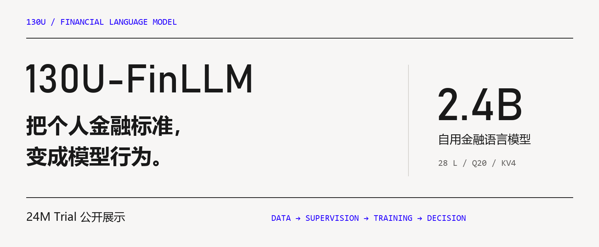
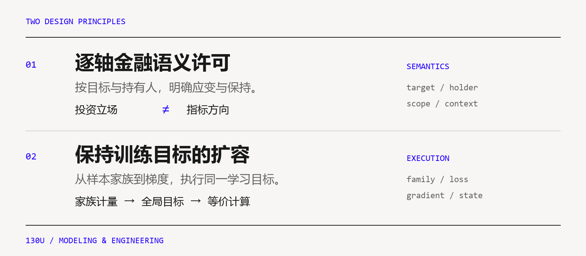

# 130U-FinLLM

**把个人金融标准，变成模型行为。**

[项目介绍](docs/PROJECT_OVERVIEW.md) · [模型架构](docs/MODEL_CARD.md) · [训练体系](docs/TRAINING_SYSTEM.md) · [运行 Trial](docs/TRIAL_GUIDE.md)



130U-FinLLM 是面向个人金融研究的专用语言模型项目。它结合本人原创的历史金融观点与人工审核的公开文本，围绕**目标、观点持有人、证据范围和判断条件**组织学习任务，让金融判读拥有明确的依据。

项目包含 **2.4B 自用版本**与 **24M 公开 Trial**。这里展示项目方法、模型架构和训练流程，并提供 Trial 的代码、配置、Notebook 与实验记录。

## 两种规模，一条训练路径

| | 2.4B 自用版本 | 24M 公开 Trial |
|---|---|---|
| 角色 | 个人金融研究与专用模型体系 | 公开训练实践与工程复现 |
| 总参数 | 2,397,459,968 | 24,255,744 |
| 主干 | 28 层 · hidden 2,560 · Q20 / KV4 | 6 层 · hidden 512 · Q8 / KV4 |
| 词表 / 上下文 | 65,536 / 4,096 | 8,192 / 512 |
| 阅读入口 | [架构与技术设计](docs/MODEL_CARD.md) | [配置](configs/model_24m.json) · [实验记录](docs/experiment-results.md) |

先用 24M 打通语料、监督、训练和评价，再把任务协议与工程方法扩展到 2.4B。迁移的是判断标准、实验方法和状态语义；词表、权重、运行时与校准按各自版本管理。

## 两项核心设计



**金融语义许可监督。** “营收增长”与“作者看多”属于不同任务轴。对目标切换、引用、否定和条件变化分别规定哪些答案需要重标、哪些应当保持，并区分标签保持与概率保持，让监督服从金融语义。[方法说明 →](docs/TRAINING_SYSTEM.md#金融语义许可)

**保持训练目标的扩容工程。** 从样本家族与有效监督位置计量，到完整词表损失、分段 attention、多卡归约与恢复语义，将数据、损失和运行时连接为同一训练契约。[计算路径 →](docs/TRAINING_SYSTEM.md#训练目标与运行时)

## 从语料到判读

1. **定义任务与数据边界**：整理来源、目标和观点持有人，先划分家族，再生成训练视图。
2. **基础语言预训练**：从随机初始化学习语言结构与上下文关系。
3. **金融混合适配**：联合金融原文、通用材料、阅读问答与目标任务。
4. **任务训练与交付**：目标条件化 SFT，依次完成开发选模、概率校准、接受规则选择与独立测试。

[查看完整训练图](assets/training_workflow.svg) · [查看核心计算图](assets/training_compute.svg) · [阅读项目介绍 PDF](docs/130U-FinLLM.pdf)

## 从公开 Trial 开始

```bash
git clone https://github.com/130U/130U-FinLLM.git
cd 130U-FinLLM
python -m pip install -e .
python -m finllm smoke --device cpu --output runs/first-smoke
```

`smoke` 使用小型合成配置检查 tokenizer、训练、恢复、校准与预测链路。24M 配置位于 [`configs/model_24m.json`](configs/model_24m.json)；准备自己的语料并运行各阶段，请按 [Trial 使用指南](docs/TRIAL_GUIDE.md) 操作。训练数据、检查点与自用版本权重单独管理。

## 深入阅读

| 内容 | 入口 |
|---|---|
| 项目动机、版本演进与技术特色 | [项目介绍](docs/PROJECT_OVERVIEW.md) |
| 参数、层结构与两个版本的对应关系 | [模型说明](docs/MODEL_CARD.md) |
| 数据、语义监督、全局目标与训练计算 | [训练体系](docs/TRAINING_SYSTEM.md) |
| 类别学习、任务语义、实验归因与扩容 | [工程复盘](docs/ENGINEERING.md) |
| 公开代码、数据准备与运行入口 | [Trial 指南](docs/TRIAL_GUIDE.md) |
| 公开实验结果与逐类分析 | [Trial 实验记录](docs/experiment-results.md) |

## 许可与来源

公开代码采用 [Apache-2.0](LICENSE)。Trial 主干实现参考 MiniMind，来源和修改说明见 [THIRD_PARTY_NOTICES](THIRD_PARTY_NOTICES.md)。代码许可与数据、权重许可分别管理。
