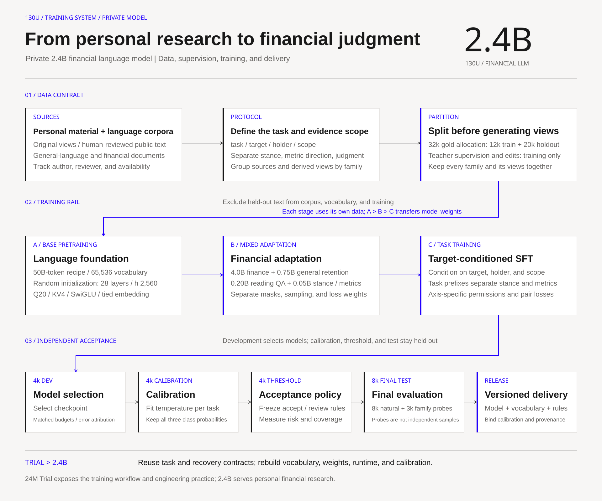
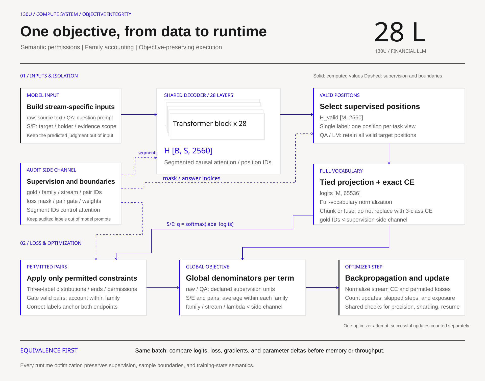

# 130U-FinLLM

**A 2.4B financial language model for personal use · A public 24M Trial**

## Turning personal financial standards into model behavior

I built 130U-FinLLM to turn my financial research experience into a language model system that I can use, explain, and improve over time. It brings together my original historical financial views and public financial texts that I have personally reviewed, organized around one question: **Who is expressing a judgment about what, on which evidence, and under what conditions would that judgment change?**

The project has two versions. The 24M Trial exposes the engineering process from data preparation and language pretraining to task adaptation. The 2.4B version is intended for personal financial research, with financial semantics and a unified multitask training system at its core. The public repository presents the Trial's code, experiments, and engineering methods.

I chose to control the system at the training level: how material enters the model, where supervision applies, how tasks share representations, and how outputs enter my research workflow. Personal material serves two purposes. Original views capture my analytical habits, while human judgments establish consistent interpretation standards.

Two designs organize the project: **financial semantic permissions**, which specify the changes a model should respond to, and **objective-preserving scaling**, which keeps those requirements intact through data augmentation, multitask training, and larger-scale execution.

## Validate with 24M, then extend the system to 2.4B

The 24M model is the engineering starting point. Its size makes the training process observable, helps isolate interactions between data, labels, optimization, and evaluation, and connects each adjustment to specific examples and computation records.

The most useful early finding was the gap between aggregate accuracy and actual task performance. The initial Trial predicted neutral for every development example. Accuracy was still 75.25%, while recall for both directional classes was zero. Adjusting class exposure and training budget restored directional predictions but also increased directional false positives on neutral text. This established a principle for the project: **evaluate what the model learns and the additional errors it introduces to learn it.**

The 2.4B version carries forward the task protocol, error analysis, and experimental methods. Vocabulary, model weights, context handling, training state, and probability calibration are rebuilt for the larger version rather than inherited as if small-model settings were sufficient.

| Architecture | 24M Trial | 2.4B private version |
|---|---:|---:|
| Total parameters | 24,255,744 | 2,397,459,968 |
| Transformer layers | 6 | 28 |
| Hidden size | 512 | 2,560 |
| FFN intermediate size | 1,664 | 8,320 |
| Q / KV heads per layer | 8 / 4 | 20 / 4 |
| Vocabulary / context limit | 8,192 / 512 | 65,536 / 4,096 |

The backbone uses a dense decoder, GQA, RoPE, RMSNorm, and SwiGLU, with tied input embeddings and vocabulary projection weights. Each 2.4B layer has 20 query heads and 4 key/value heads, with a head dimension of 128. This provides a shared computational basis for financial text, target conditions, and multitask supervision.

The 2.4B scale accommodates more complex target relationships and financial language while keeping parameter count, training-state memory, and runtime implementation manageable. Data quality, supervision design, and computational efficiency receive equal attention.

## Four stages from source material to model use

### 1. Organize material into explicit learning tasks

The data system distinguishes my original views, public texts I have reviewed, general-language material, and financial source text. Each task identifies its target, opinion holder, evidence scope, and information availability time. Source-text stance, metric direction, and my own judgment have separate definitions.

Original text, target queries, question-answer pairs, and edits concerning the same event belong to one sample family. Families are split before derivative views are generated, so related material stays in the same partition. The 2.4B recipe allocates 32,000 human gold records: 12,000 for training, 4,000 for development, 4,000 for calibration, 4,000 for threshold selection, and 8,000 for final testing. These are recipe allocations; actual inventories and consumption are recorded separately.

### 2. Establish language foundations

The foundation stage starts from random initialization and uses next-token prediction to learn language structure and contextual relationships. Its recipe allocates 50B input tokens and uses a vocabulary of 65,536. Tokenizer construction and pretraining follow the same evaluation-exclusion boundaries.

### 3. Adapt through a financial mixture

The adaptation recipe allocates 5B input tokens: 4B financial source text, 0.75B general material, 0.20B reading questions and answers, and 0.05B stance and event tasks. Financial text supplies domain language, general material maintains language coverage, and QA and task supervision connect evidence to outputs. Sampling, supervised positions, and loss weights are managed separately for each stream.

### 4. Train tasks, calibrate, and package the model

Target-conditioned SFT applies financial semantic permissions to supervision, separating investment stance from metric direction. The workflow then proceeds through development-set model selection, probability calibration, acceptance-rule selection, and final testing. A release binds the model, tokenizer, task protocol, calibration parameters, and version information, so every prediction belongs to a defined system configuration.

The workflow connects source material, interpretation standards, language learning, financial adaptation, and task training to structured judgments and human review. Usage feedback informs the next round of training-data preparation, with new independent examples used to evaluate updates.

## Design 1: Financial semantic permissions

Financial text often combines changes in facts, an author's attitude, and investment actions. Compressing them into a single positive/negative label can teach a model to detect sentiment words while answering the wrong question.

For example: **“Company A's revenue grew year over year, but I am still reducing my position in A.”** The metric direction is upward, while the expressed investment stance may be bearish. If the reduction reflects portfolio or hedging constraints, the task's allowed context also matters.

The supervision protocol evaluates each task axis separately. Every edit is reviewed for its effect on the target, opinion holder, and task. Changes with a clear new answer receive a new label. Semantically preserved components retain their labels. Where the relationship is indeterminate, no cross-example constraint is imposed.

### Separate label preservation from probability preservation

A meaning-preserving paraphrase can justify keeping output distributions close. An additional piece of evidence in the same direction may preserve the class while reasonably increasing confidence. The system therefore records separate permissions for label preservation and distribution preservation, allowing consistency constraints to follow semantics.

Correct labels at both endpoints anchor training. Strictly equivalent edits receive a distribution-consistency constraint; valid changes receive a relative-response constraint that moves predictions toward the new correct direction. Reviewed labels, edit names, and permission records control supervision without entering the model prompt as answer cues.

### Express financial judgments as inspectable relationships

The contribution connects targets, opinion holders, conditions, and evidence scope to concrete edit rules and loss calculations. Behavioral requirements become explicit: preserve the judgment under irrelevant wording changes, respond to meaningful changes, and resolve attribution again when a quotation or target changes.

Task prefixes distinguish stance from event direction while sharing the same backbone. The semantic protocol specifies where the tasks may support each other and where their information must remain separate.

## Design 2: Objective-preserving scaling

A difficult scaling failure is easy to miss: the code still runs and the loss still falls, but the model is optimizing a different objective. Data accounting and runtime optimization therefore belong to one training contract that specifies what each computation must preserve.

### At the data level, define learning weight explicitly

Source text supplies many next-token targets. QA primarily supervises answers, while a stance record usually supplies one label. Twenty edits of one original text do not become twenty independent events.

The training objective separately accounts for natural examples, sample families, task views, and supervised positions. Reviewed views are aggregated within families before task-level aggregation; natural examples retain their own distribution. Stream frequency, task weight, and repeated exposure are logged separately so the implemented objective can be reconstructed from the training ledger.

Distributed training and gradient accumulation use denominators covering the entire update. With W ranks and a reducer that averages rank gradients, each rank uses `W × λ × local loss sum / global effective denominator` for terms whose global denominator is positive. Globally absent terms are omitted; locally absent terms still follow the same communication order. Splitting a fixed effective batch across microbatches or devices should not unintentionally change its learning objective.

### At the computation level, preserve supervision and information boundaries

For single-label tasks, the runtime selects the hidden state that predicts the answer before applying the full-vocabulary projection and cross-entropy loss. The backbone still processes the entire context; the omitted work is the output projection at positions without direct supervision. With batch size 2, sequence length 2,048, vocabulary size 65,536, and FP32 logits, the full output tensor occupies 1 GiB. Selecting two supervised positions reduces that tensor to 0.5 MiB. This difference follows directly from tensor shapes.

Packing uses segmented causal attention so one example cannot read an adjacent example's answer. Input embeddings and the output head remain the same parameter object. Sharding and restoration jointly manage optimizer state, random state, and data-consumption position.

Validation proceeds through effective-position outputs, individual loss terms, gradients, and parameter updates. This ties resource savings to experimental meaning: data defines the objective, and the runtime must execute it accurately.

## Engineering challenges at the boundaries between definitions

### Make the model, annotator, and user answer the same question

A headline and a full article can support different answers, as can the author's view and my own judgment, or operating facts and investment stance. Task fields and annotation rules make these distinctions explicit, allowing errors to be traced to a target, role, or evidence scope. Personal judgments additionally require the information, horizon, and constraints available at the time to explain why a view changed.

This requires more precise data preparation, but yields more stable supervision. Every label corresponds to a defined question and an allowed set of information.

### Connect additional training to identifiable gains

The Trial's class failure showed that more correct answers do not necessarily mean better performance on the important part of the task. Independent examples, repeated exposures, supervised positions, and update counts are recorded together, connecting sampling changes to compute budgets. Semantic constraints also need comparison against ordinary cross-entropy on the same edited examples, separating the contribution of new data from that of the loss design.

Moving from 24M to 2.4B extends this problem to multiple streams and devices. Global denominators and family accounting give the recipe an inspectable mathematical meaning and each change a clearer basis for attribution.

### Preserve the training problem while optimizing execution

Counting FP32 parameters, gradients, and two Adam state tensors, the 2.4B model requires approximately 38.36 GB for its main training state, before activations and temporary tensors. Precision, sharding, recomputation, and packing are therefore integral to runtime design.

Each optimization changes execution while preserving the supervision objective, permitted information flow, and state semantics. Projection positions may change while full-vocabulary loss is retained. Examples may be packed while attention remains isolated. Devices may change while effective gradient weights remain consistent.

## A model route for personal financial research

Financial models at a similar scale pursue different tasks. Eva-4B classifies answer quality in earnings calls, FinanceParam 2.9B organizes supervision around financial knowledge and demographic contexts, and FinLCR-4B focuses on long-document financial reasoning.[1][2][3]

130U-FinLLM focuses on **learning personal financial standards and modeling relationships between targets, opinion holders, and evidence**. Financial semantic permissions and training-objective accounting connect material, supervision, computation, and use.

MCP, tools, skills, and ASR serve complementary roles: connecting sources, retrieving data, running calculations, managing workflows, and transcribing speech. The specialized model handles recurring interpretation tasks, while tools and retrieval supply information that changes over time.

The 24M Trial is the public window into the project's methods; the 2.4B version serves the private research workflow. The path from data and class failures to semantic supervision, multitask accounting, and runtime scaling demonstrates the ability to **define a problem, organize data, design supervision, control computation, and integrate model outputs into financial research.**

### Technical references

The combined design builds on established language-model and training methods. Counterfactual behavior tests and supervised-position projection provide relevant foundations for the semantic protocol and runtime design.[4][5] Third-party attribution for the backbone is retained in the public Trial repository.

1. [Eva-4B: Financial answer-quality classification](https://huggingface.co/FutureMa/Eva-4B)
2. [FinanceParam: A 2.9B financial adaptation model](https://huggingface.co/bharatgenai/FinanceParam)
3. [FinLCR: Financial long-context reasoning](https://aclanthology.org/2026.finnlp-1.3/)
4. [ARTS: Target-aware behavioral robustness testing](https://aclanthology.org/2020.emnlp-main.292/)
5. [Cut Your Losses: Supervised positions and output computation](https://arxiv.org/abs/2411.09009)

## Training workflow

## Core training computation

